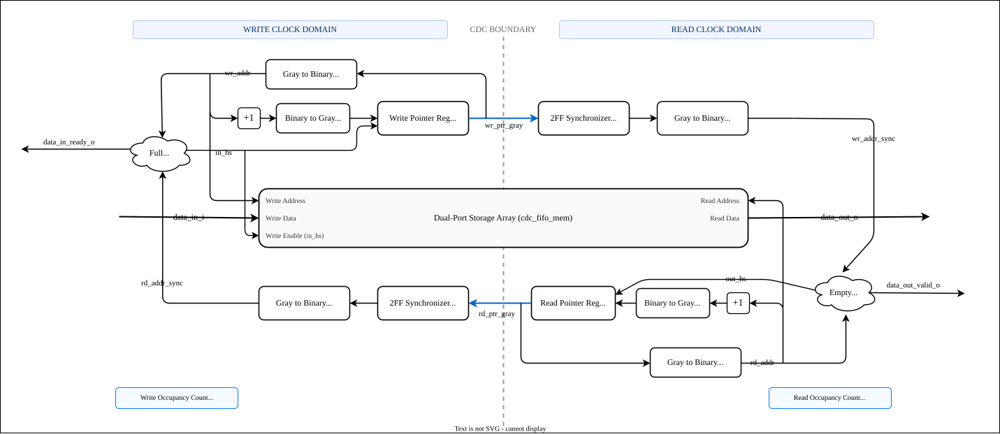
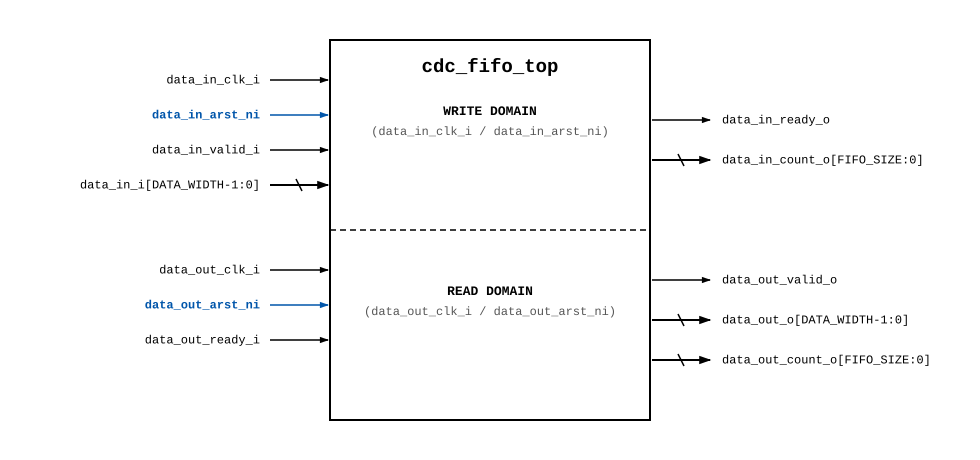

# Parameterized Clock Domain Crossing (CDC) Asynchronous FIFO

[-blue.svg)]()
[]()
[]()
[]()
[]()

**Author:** Shantanu Paul  
**Module Name:** `cdc_fifo_top`  
**Testbench:** `shantanu_self_tb`

---

## 1. Executive Summary

This repository contains a silicon-ready, parameterizable **Asynchronous Clock Domain Crossing (CDC) FIFO** implemented in SystemVerilog (IEEE 1800-2017). Designed for high-reliability data movement between asynchronous clock domains (e.g., high-speed front-end ADC/PCIe DMA engines and downstream DSP/AXI fabrics), it features:

- **Single-Register Gray Pointer Architecture:** Pointers are registered strictly in Gray code, guaranteeing that only a single bit changes per increment across clock domain boundaries, eliminating multi-bit CDC race hazards.
- **On-the-Fly Binary Conversion:** Low-latency combinational Gray-to-Binary decoders derive binary addresses dynamically for dual-port SRAM memory indexing and pointer arithmetic without pipeline delays.
- **Dual Independent Asynchronous Resets:** Separate active-low resets (`data_in_arst_ni` and `data_out_arst_ni`) ensure isolated initialization of write and read domains.
- **Ready/Valid Handshake Protocol (AXI-Stream Compatible):** First-Word Fall-Through (FWFT) architecture with robust backpressure signaling (`data_in_ready_o`) and output valid qualification (`data_out_valid_o`).
- **Real-Time Occupancy Counters:** Domain-safe word counters (`data_in_count_o`, `data_out_count_o`) allowing DMA controllers to query available buffer capacity dynamically, preventing burst buffer overruns and data loss.
- **Metastability Hardening:** Parameterized cascaded 2-stage DFF synchronizers resolve cross-domain metastability.
- **Formal Protocol Assertions (SVA):** Embedded SystemVerilog Assertions enforce standard ready/valid protocol compliance (stability during backpressure).

---

## 2. Architecture & Block Diagram

The payload is stored in a dedicated dual-port SRAM and **never** crosses clock boundaries directly; only Gray-coded pointers traverse the 2-stage synchronizers.

### Top-Level Architecture


### Top-Level Module Pinout


---

## 3. Top-Level Interface Specification

| Port Name | Direction | Width | Clock Domain | Description |
| :--- | :---: | :---: | :---: | :--- |
| `data_in_clk_i` | Input | `1` | Write | Producer clock reference |
| `data_in_arst_ni` | Input | `1` | Write | Asynchronous active-low write-domain reset |
| `data_in_i` | Input | `DATA_WIDTH` | Write | Input payload data |
| `data_in_valid_i` | Input | `1` | Write | Producer indicates data is valid for transfer |
| `data_in_ready_o` | Output | `1` | Write | Backpressure indicator (`!full`). Transaction commits on `valid_i && ready_o` |
| `data_in_count_o` | Output | `FIFO_SIZE+1` | Write | Stored word count visible in write domain (`wr_ptr - rd_ptr_sync`) |
| `data_out_clk_i` | Input | `1` | Read | Consumer clock reference |
| `data_out_arst_ni` | Input | `1` | Read | Asynchronous active-low read-domain reset |
| `data_out_o` | Output | `DATA_WIDTH` | Read | Output payload presenting oldest unread word (FWFT) |
| `data_out_valid_o` | Output | `1` | Read | Indicates readable data available (`!empty`). Commits on `valid_o && ready_i` |
| `data_out_ready_i` | Input | `1` | Read | Consumer indicates readiness to absorb data |
| `data_out_count_o` | Output | `FIFO_SIZE+1` | Read | Stored word count visible in read domain (`wr_ptr_sync - rd_ptr`) |

### Configurable RTL Parameters

| Parameter | Type | Default | Description |
| :--- | :---: | :---: | :--- |
| `DATA_WIDTH` | `int` | Top-specified (`4`) | Payload bit width per word (e.g. 4, 8, 16, 32, 64) |
| `FIFO_SIZE` | `int` | Top-specified (`4`) | Log2 of buffer depth (`DEPTH = 2^FIFO_SIZE = 16` words) |
| `SYNC_STAGES` | `int` | Top-specified (`2`) | Number of flip-flop synchronizer stages |
| `PTR_WIDTH` | `int` | `FIFO_SIZE + 1` | Pointer width accommodating the wrap-around bit |

---

## 4. Submodule Decomposition

```
Intern_practise/
├── source/
│   ├── cdc_fifo_top.sv       # Top integration, flag generation, protocol SVA assertions
│   ├── cdc_2ff_sync.sv       # Parameterized N-stage DFF metastability synchronizer
│   ├── cdc_bin2gray.sv       # Parameterized Binary-to-Gray combinational encoder
│   ├── cdc_gray2bin.sv       # Parameterized Gray-to-Binary combinational decoder
│   ├── cdc_fifo_mem.sv       # Dual-port RAM array (asynchronous read, synchronous write)
│   └── fifo_reg.sv           # Enabled register with asynchronous active-low reset
├── interface/
│   └── cdc_fifo_if.sv        # Bundled SystemVerilog interface
├── testbench/
│   └── shantanu_self_tb.sv   # 10-step self-checking linear & stress testbench
├── documents/
│   ├── src/                  # Architectural diagrams (.svg and editable .drawio)
│   └── tb/                   # Verification plan & test error documentation
└── Makefile                  # Vivado simulation automation
```

---

## 5. Verification Suite & Test Coverage

The testbench (`testbench/shantanu_self_tb.sv`) implements an automated 10-step self-checking suite verifying functionality, CDC synchronization, corner-case backpressure, and frequency ratio sweeps:

| Step | Test Objective | Stimulus & Check Mechanism | Status |
| :---: | :--- | :--- | :---: |
| **1** | **Reset Initialization** | Asserts both resets; verifies `ready_o=0`, `valid_o=0`. Deasserts resets; verifies `ready_o=1`, `counts=0`. | **PASS** |
| **2** | **Single Word Integrity** | Writes random word, waits for cross-domain synchronizer latency, verifies data payload and empty flag return. | **PASS** |
| **3** | **FIFO Full Detection** | Fills FIFO to capacity (`DEPTH = 16`); verifies `data_in_ready_o=0` and `data_in_count_o=DEPTH`. | **PASS** |
| **4** | **Overflow Backpressure** | Verifies backpressure holds stably without dropping existing memory words or violating SVA stability rules. | **PASS** |
| **5** | **Empty Detection & Order**| Drains all words; verifies strict First-In, First-Out sequence and assertion of empty flags (`valid_o=0`, `count=0`). | **PASS** |
| **6** | **Underflow Protection** | Consumer asserts `data_out_ready_i=1` while empty; verifies zero spurious reads or pointer drift occur. | **PASS** |
| **7** | **Clock Ratio Sweep (5:1)**| Fast write domain (100 MHz) vs. slow read domain (20 MHz); verifies reliable synchronizer handshake without loss. | **PASS** |
| **8** | **Clock Ratio Sweep (1:5)**| Slow write domain (20 MHz) vs. fast read domain (100 MHz); verifies zero duplicate read transactions. | **PASS** |
| **9** | **Concurrent R/W (`fork`)** | Concurrent asynchronous write and read transactions operating in parallel across distinct clock phases. | **PASS** |
| **10** | **DMA Burst via Occupancy** | DMA checks `data_in_count_o`, bursts exact available capacity (`DEPTH - count`), verifying 100% delivery with 0 dropped words. | **PASS** |

### Execution Log Output

```text
==================================================
 Running Shantanu CDC FIFO Verification (Steps 1-10)
 Target DUT: cdc_fifo_top (DATA_WIDTH=4, DEPTH=16)
==================================================
[STEP 1] Reset initialization ........................... PASS
[STEP 2] Single write/read data integrity ............... PASS
[STEP 3] FIFO full detection ............................ PASS
[STEP 4] Overflow backpressure protection ............... PASS
[STEP 5] FIFO empty detection and ordering .............. PASS
[STEP 6] Underflow protection ........................... PASS
[STEP 7] Clock ratio sweep (5:1 fast-write) ............. PASS
[STEP 8] Clock ratio sweep (1:5 slow-write) ............. PASS
[STEP 9] Concurrent read/write operation ................ PASS
[STEP 10] DMA burst transfer verified with occupancy ...... PASS

==================================================
 CDC FIFO Verification Summary
 Final Status : ALL TESTS PASSED (10/10 Steps)
==================================================
```

---

## 6. How to Run the Simulation

### Prerequisites
- AMD Vivado (v2020.1 or newer) with `xvlog`, `xelab`, and `xsim` on your `PATH`.
- Bash / PowerShell with GNU Make.

### Option 1: Automated Makefile
From the repository root (`Intern_practise/`):

```bash
# Clean, compile, elaborate, and run all 10 tests
make all

# Or run directly without clean
make run
```

### Option 2: Direct Command Line (Windows PowerShell / Linux Terminal)

```powershell
# 1. Compile SystemVerilog source and testbench files
xvlog -sv interface/cdc_fifo_if.sv source/*.sv testbench/shantanu_self_tb.sv

# 2. Elaborate the design snapshot
xelab shantanu_self_tb -s snap_tb -debug all

# 3. Execute simulation
xsim snap_tb -runall
```

---

## 7. Waveform Inspection

Simulation automatically dumps standard VCD waveforms to `dump.vcd`.

- **GTKWave (Open-Source):**
  ```bash
  gtkwave dump.vcd
  ```
- **Vivado GUI:**
  ```powershell
  xsim snap_tb -gui
  ```

---

## 8. SVA Protocol Assertions Included

In `source/cdc_fifo_top.sv`:
```systemverilog
// Write side: data must remain stable during unaccepted handshake
assert property (
    @(posedge data_in_clk_i) disable iff (!data_in_arst_ni)
    (data_in_valid_i & ~data_in_ready_o) |=> $stable(data_in_i)
);

// Write side: valid must not be dropped prematurely
assert property (
    @(posedge data_in_clk_i) disable iff (!data_in_arst_ni)
    (data_in_valid_i & ~data_in_ready_o) |=> data_in_valid_i
);

// Read side: output data must remain stable during unaccepted read handshake
assert property (
    @(posedge data_out_clk_i) disable iff (!data_out_arst_ni)
    (data_out_valid_o & ~data_out_ready_i) |=> $stable(data_out_o)
);

// Read side: valid must not deassert prematurely
assert property (
    @(posedge data_out_clk_i) disable iff (!data_out_arst_ni)
    (data_out_valid_o & ~data_out_ready_i) |=> data_out_valid_o
);
```
